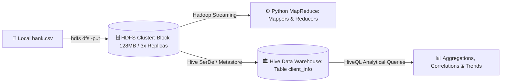

# 📚 Study Guide 01: Hadoop HDFS & Apache Hive Architecture
**Date:** 2026-10-12  
**Domain:** Distributed Data Storage & Analytical Querying  
**Author:** Jignesh (AlmaBetter Masters Data Science)  
**Agent:** Antigravity AI Assistant  
**Dataset:** `bank.csv` (4,521 records, 17 features)

---

## 1. 🎯 Overview & Objectives
This module establishes the foundational data lake and warehouse architecture for enterprise banking. The objective is to understand how massive datasets are ingested into Hadoop Distributed File System (HDFS), transformed using MapReduce Python Streaming, and queried declaratively using Apache Hive.

---

## 2. 🏛️ Core Concepts & Architecture Breakdown


### Key Distributed Architecture Principles:
* **HDFS (Distributed Storage)**: Files are split into blocks (default 128MB) and distributed across commodity DataNodes. Master NameNode manages the namespace and metadata. 3x replication guarantees fault tolerance.
* **MapReduce (Batch Computation)**:
  * **Map Phase**: Worker nodes read local HDFS blocks line-by-line, extract fields, and emit intermediate key-value pairs `(key, value)`.
  * **Shuffle & Sort Phase**: Hadoop automatically groups and sorts all emitted keys across the network so identical keys arrive at the same Reducer.
  * **Reduce Phase**: Aggregates grouped values to compute metrics (sums, counts, averages).
* **Apache Hive (SQL on Hadoop)**: Translates declarative SQL-like HiveQL queries into underlying MapReduce or Tez jobs, querying files directly in HDFS without requiring explicit ingestion into a relational database engine.

---

## 3. 💻 Executable Implementations & Commands

### 3.1 HDFS Setup Commands
```bash
# Start daemons
start-dfs.sh
start-yarn.sh

# Create banking input directory
hdfs dfs -mkdir -p /user/hadoop/banking_data/input

# Transfer bank.csv to HDFS
hdfs dfs -put bank.csv /user/hadoop/banking_data/input/

# Verify storage and blocks
hdfs dfs -ls -h /user/hadoop/banking_data/input/
```

### 3.2 Python MapReduce: Job vs. Average Balance
```bash
# Hadoop Streaming execution
mapred streaming \
  -files mapper_job_balance.py,reducer_job_balance.py \
  -mapper "python3 mapper_job_balance.py" \
  -reducer "python3 reducer_job_balance.py" \
  -input /user/hadoop/banking_data/input/bank.csv \
  -output /user/hadoop/banking_data/output/job_balance
```

### 3.3 Hive DDL & Table Definition
```sql
CREATE DATABASE IF NOT EXISTS banking_data;
USE banking_data;

CREATE TABLE client_info (
    age INT, job STRING, marital STRING, education STRING, `default` STRING,
    balance INT, housing STRING, loan STRING, contact STRING, day INT,
    month STRING, duration INT, campaign INT, pdays INT, previous INT,
    poutcome STRING, y STRING
)
ROW FORMAT DELIMITED FIELDS TERMINATED BY ','
STORED AS TEXTFILE
TBLPROPERTIES ("skip.header.line.count"="1");

LOAD DATA LOCAL INPATH 'bank.csv' OVERWRITE INTO TABLE client_info;
```

---

## 4. 📊 Data Insights & Ground Truth Findings
* **Top Liquid Job Categories**:
  * **Retired**: Average Balance = **$2,319.19** (Count: 230)
  * **Housemaid**: Average Balance = **$2,083.80** (Count: 112)
  * **Management**: Average Balance = **$1,766.93** (Count: 969)
* **Demographic Wealth Gradient**:
  * `<30` years: **$1,058.10**
  * `30-45` years: **$1,372.22**
  * `46-60` years: **$1,530.14**
  * `>60` years: **$2,676.35** (No negative balances!)
* **Housing Loans by Education**: Secondary education holds the highest housing loan rate (**62.01%**).
* **Correlation**: Pearson correlation between age and balance is **+0.0838** (Weak linear relationship).

---

## 5. 🎙️ Interview Defense Questions
### Q1: Why use Hadoop HDFS rather than traditional RDBMS for banking data?
**Answer:** Traditional RDBMS systems scale vertically (requiring costly multi-core servers) and suffer bottlenecks when ingesting high-velocity petabyte-scale transactions. HDFS scales horizontally across commodity hardware, stores structured and semi-structured logs seamlessly, and guarantees fault tolerance via automatic 3x block replication.

### Q2: What is the difference between Managed and External tables in Hive?
**Answer:** For a **Managed table**, Hive owns the underlying HDFS directory and metadata. Dropping the table deletes both metadata and HDFS data. For an **External table**, Hive only manages metadata; dropping the table leaves the underlying HDFS files intact, preventing accidental data loss in shared data lakes.
