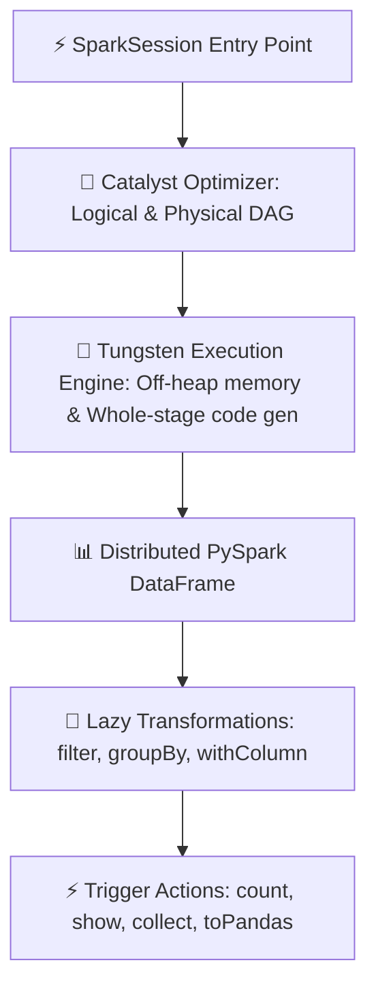

# 📚 Study Guide 02: PySpark Large-Scale Exploratory Data Analysis
**Date:** 2026-10-12  
**Domain:** Distributed In-Memory Exploratory Data Analysis  
**Author:** Jignesh (AlmaBetter Masters Data Science)  
**Agent:** Antigravity AI Assistant  
**Dataset:** `bank.csv` (4,521 records, 17 features)

---

## 1. 🎯 Overview & Objectives
Analyze customer behavioral trends, demographic distributions, and telemarketing performance using Apache Spark's DataFrame API and Spark SQL.

---

## 2. 🏛️ Core Concepts Breakdown


### PySpark Key Mechanics:
* **Lazy Evaluation**: Transformations (`filter`, `select`, `groupBy`) do not compute immediately. Spark records them into a Directed Acyclic Graph (DAG) and optimizes the query plan via the **Catalyst Optimizer** before executing when an Action (`count()`, `show()`) is called.
* **UDFs (User-Defined Functions)**: Allow custom Python functions to be applied across distributed partitions, though built-in Spark SQL functions are prioritized when possible to avoid JVM-to-Python serialization overhead.

---

## 3. 💻 Executable Code Reference

### 3.1 Initializing Spark & Filtering
```python
from pyspark.sql import SparkSession
from pyspark.sql.functions import col, when, count, avg, round as spark_round, udf
from pyspark.sql.types import StringType

spark = SparkSession.builder.appName("Spark_EDA").getOrCreate()
df = spark.read.csv("bank.csv", header=True, inferSchema=True)

# High balance filter
high_bal = df.filter(col("balance") > 1000)
print("Balance > 1000:", high_bal.count())

# Derive Calendar Quarter
df = df.withColumn(
    "quarter",
    when(col("month").isin(["jan", "feb", "mar"]), "Q1")
    .when(col("month").isin(["apr", "may", "jun"]), "Q2")
    .when(col("month").isin(["jul", "aug", "sep"]), "Q3")
    .otherwise("Q4")
)
```

### 3.2 Age Categorization UDF
```python
def categorize_age(age):
    if age < 30: return "<30"
    elif age <= 60: return "30-60"
    else: return ">60"

age_udf = udf(categorize_age, StringType())
df = df.withColumn("age_group", age_udf(col("age")))
df.groupBy("age_group").count().show()
```

---

## 4. 📊 Crucial Empirical Findings
* **Severe Campaign Seasonality**:
  * **May**: 1,398 contacts (30.9% of total volume) -> Only **6.65%** conversion rate.
  * **October**: 80 contacts -> **46.25%** conversion rate.
  * **December**: 20 contacts -> **45.00%** conversion rate.
  * **March**: 49 contacts -> **42.86%** conversion rate.
* **Duration as an Interest Indicator**:
  * Subscribed clients average call duration: **552.74 sec (~9.2 min)**.
  * Non-subscribed clients average call duration: **226.35 sec (~3.8 min)**.
  * Conversion calls are **2.44x longer**.
* **Credit Default Risks**:
  * **Entrepreneurs**: 4.17% default rate (Highest in bank).
  * **Unemployed**: 2.34% default rate.
  * **Self-employed**: 2.19% default rate.

---

## 5. 🎙️ Interview Defense Questions
### Q1: Why is Apache Spark preferred over Pandas for enterprise EDA?
**Answer:** Pandas loads the entire dataset into a single CPU core's virtual memory (RAM), crashing with Out-Of-Memory errors on large datasets. Apache Spark distributes data across worker partitions, optimizes execution plans via the Catalyst optimizer, and spills gracefully to disk if memory limits are reached.
