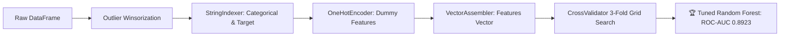

# 📚 Study Guide 03: Spark ML Predictive Modeling & Pipelines
**Date:** 2026-10-12  
**Domain:** Scalable Machine Learning (Binary Classification)  
**Author:** Jignesh (AlmaBetter Masters Data Science)  
**Agent:** Antigravity AI Assistant  
**Dataset:** `bank.csv` (Target: `y` - Term Deposit Subscription)

---

## 1. 🎯 Overview & Objectives
Build, evaluate, and tune distributed classification models using `pyspark.ml` to predict customer term deposit subscriptions while resolving severe class imbalance (88.5% no vs 11.5% yes).

---

## 2. 🏛️ Core Concepts Breakdown


### Key Spark ML Pipeline Architecture:
* **Transformers vs Estimators**:
  * **Transformer**: An algorithm that transforms one DataFrame into another (e.g., `VectorAssembler.transform()`).
  * **Estimator**: An algorithm that fits on data to produce a Transformer (e.g., `RandomForestClassifier.fit()`).
* **Pipeline Encapsulation**: Chaining all feature engineering and modeling stages into a single pipeline guarantees that data prep parameters (e.g. string indexing vocabularies) are learned solely from training partitions, preventing data leakage.

---

## 3. 💻 Executable Pipeline Code
```python
from pyspark.ml import Pipeline
from pyspark.ml.feature import StringIndexer, OneHotEncoder, VectorAssembler
from pyspark.ml.classification import RandomForestClassifier
from pyspark.ml.evaluation import BinaryClassificationEvaluator
from pyspark.ml.tuning import ParamGridBuilder, CrossValidator

# 1. Pipeline stages
label_indexer = StringIndexer(inputCol="y", outputCol="label")
indexers = [StringIndexer(inputCol=c, outputCol=f"{c}_idx") for c in cat_cols]
encoders = [OneHotEncoder(inputCol=f"{c}_idx", outputCol=f"{c}_vec") for c in cat_cols]
assembler = VectorAssembler(inputCols=num_cols + [f"{c}_vec" for c in cat_cols], outputCol="features")

rf = RandomForestClassifier(featuresCol="features", labelCol="label", seed=42)

# 2. Hyperparameter Grid & 3-Fold Cross-Validation
param_grid = ParamGridBuilder() \
    .addGrid(rf.numTrees, [30, 60, 100]) \
    .addGrid(rf.maxDepth, [5, 10]) \
    .build()

evaluator = BinaryClassificationEvaluator(labelCol="label", metricName="areaUnderROC")
cv = CrossValidator(estimator=rf, estimatorParamMaps=param_grid, evaluator=evaluator, numFolds=3)
```

---

## 4. 📊 Model Benchmark & Feature Importance
| Model | ROC-AUC | Accuracy | PR-AUC | F1-Score |
| :--- | :--- | :--- | :--- | :--- |
| **Random Forest (Tuned)** | **0.8923** | **89.28%** | **0.5218** | **0.3951** |
| **Logistic Regression** | **0.8918** | **89.28%** | **0.5140** | **0.3899** |
| **Decision Tree** | **0.8174** | **89.17%** | **0.4320** | **0.3951** |

### Top Predictive Feature Importances:
1. `duration`: **30.95%** (Call engagement duration)
2. `poutcome_success`: **7.89%** (Prior campaign success)
3. `age`: **7.71%** (Older demographics hold more wealth)
4. `balance`: **6.96%** (Existing liquidity)
5. `day`: **5.98%** (Timing within pay cycle)

---

## 5. 🎙️ Interview Defense Questions
### Q1: Why is accuracy a misleading evaluation metric for this banking dataset?
**Answer:** Because only 11.52% of clients subscribed, a naive model predicting 100% "no" would achieve 88.48% accuracy while failing to identify a single real customer. We rely on **ROC-AUC** and **PR-AUC (Precision-Recall AUC)** to assess discriminatory ranking capability on the minority class.
