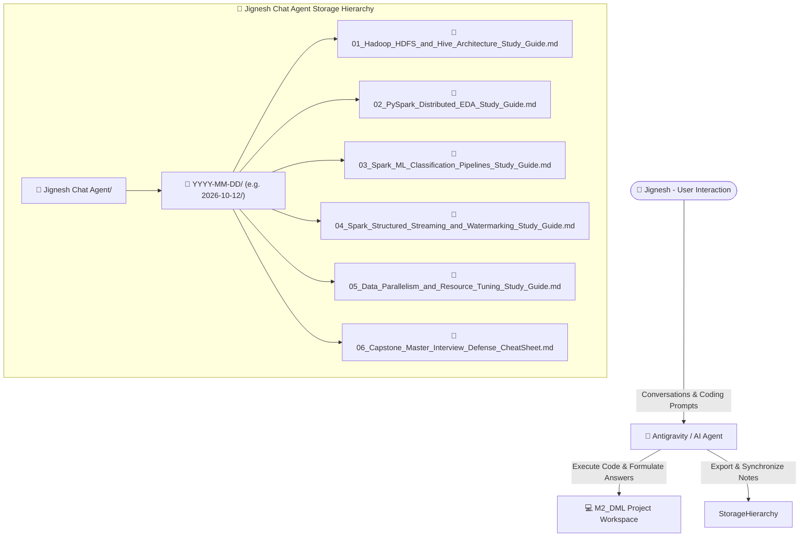

# 🧠 Jignesh Chat Agent - Structured Study Guide Archive

Welcome to the centralized study guide and chat archive system. Every agent conversation, project discussion, code walkthrough, and technical problem-solving session is systematically preserved here into structured, exam- and interview-ready Markdown study guides.

---

## 📊 Chart-Wise Architecture & Flow



---

## 🌳 Directory Tree Structure

```text
d:/Jignesh/AB_MLE/M2_DML/Jignesh Chat Agent/
│
├── README.md                                               <-- Master Index & Navigation
├── archive_session.py                                      <-- Automated Archival & Sync Utility
│
└── 2026-10-12/                                             <-- Date-stamped folder
    ├── 01_Hadoop_HDFS_and_Hive_Architecture_Study_Guide.md
    ├── 02_PySpark_Distributed_EDA_Study_Guide.md
    ├── 03_Spark_ML_Classification_Pipelines_Study_Guide.md
    ├── 04_Spark_Structured_Streaming_and_Watermarking_Study_Guide.md
    ├── 05_Data_Parallelism_and_Resource_Tuning_Study_Guide.md
    └── 06_Capstone_Master_Interview_Defense_CheatSheet.md
```

---

## 📑 Standard Study Guide Document Schema

Each `.md` study guide file follows this uniform structure:
1. **Module Header & Metadata**: Date, module name, tech stack, and primary problem statement.
2. **Core Conceptual Foundations**: Theory, distributed computing mechanics, and architecture blueprints.
3. **Executable Code Snippets**: Production scripts (Python, PySpark, HiveQL, Shell).
4. **Data Insights & Empirical Findings**: Ground truth statistics, metric tables, and benchmarks.
5. **Interview Questions & Answers (Rubric Defense)**: Direct talking points for evaluations and technical interviews.
6. **Key Takeaways & Best Practice Checklist**: Fast revision summary.

---

## 🚀 How to Add New Sessions

You can run the included automation helper from the project directory:

```bash
python "Jignesh Chat Agent/archive_session.py" --topic "Topic_Name"
```

This will automatically create a new dated folder if not already existing, and generate a standardized study guide markdown template ready to receive chat notes!
