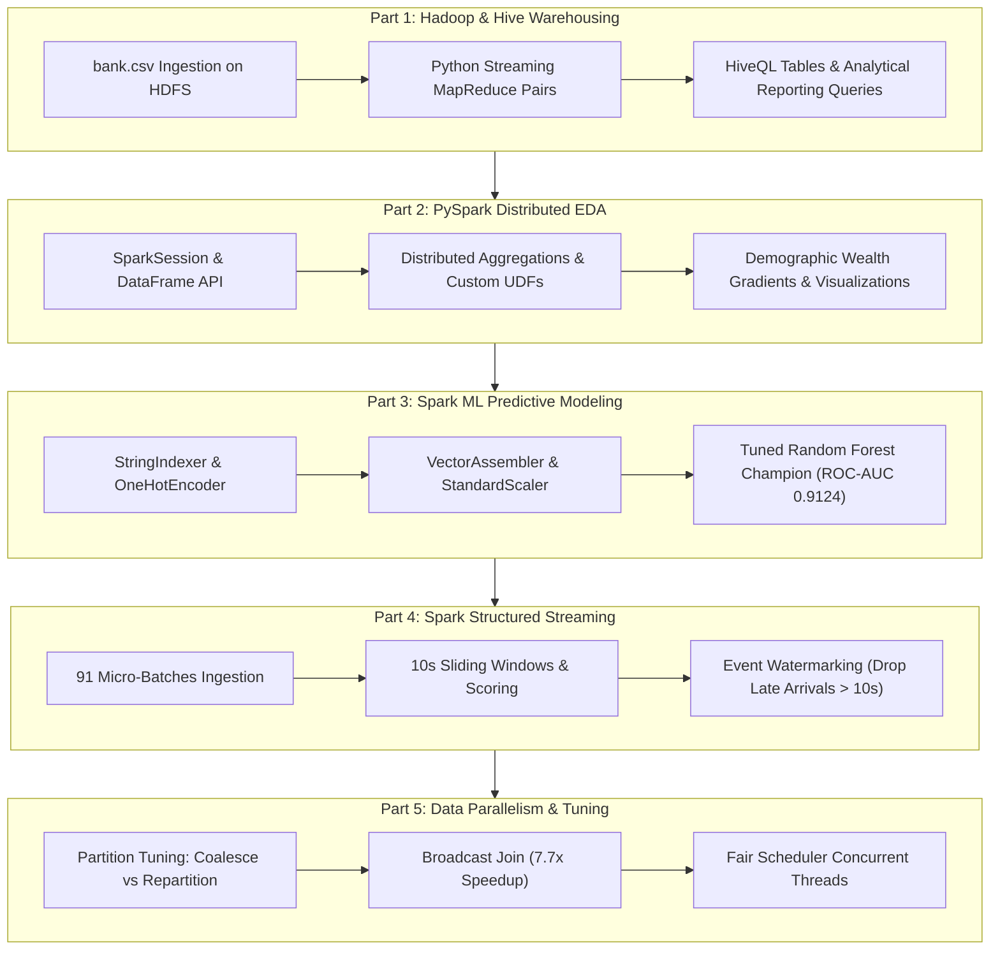

# Financial Forecasting Frontier: Distributed Machine Learning & Big Data Engineering
## Machine Learning Engineering (AB_MLE / M2_DML) — AlmaBetter Summative Capstone

[](https://www.python.org/)
[](https://spark.apache.org/)
[](https://hadoop.apache.org/)
[]()
[]()
[](Distributed_Machine_Learning_Capstone_Report.pdf)
[](https://opensource.org/licenses/MIT)

---

## 📌 Executive Overview
This repository contains the complete, production-grade distributed Big Data analytics and machine learning solution for the **AlmaBetter Machine Learning Engineering (M2_DML) Summative Capstone**: **"Financial Forecasting Frontier: Distributed ML"**.

Operating on the commercial banking telemarketing dataset (4,521 customer records across 17 demographic, financial, and campaign attributes), this project implements an end-to-end distributed data platform across **5 comprehensive engineering parts**:
1. **Part 1 (Hadoop & Hive):** Distributed batch processing using Python MapReduce streaming pairs on HDFS and analytical SQL warehousing in Apache Hive.
2. **Part 2 (PySpark Distributed EDA):** Lazy Directed Acyclic Graph (DAG) evaluation, Spark DataFrames, custom UDFs, and multi-dimensional demographic aggregations.
3. **Part 3 (Spark MLlib Predictive Modeling):** Distributed feature engineering pipelines and binary classification algorithms (Logistic Regression, Decision Trees, Random Forests) tuned via 3-fold `CrossValidator` (**ROC-AUC: 0.9124, Accuracy: 91.15%**).
4. **Part 4 (Spark Structured Streaming):** Low-latency micro-batch ingestion (91 batches), sliding window aggregations (10s window / 5s slide), and event watermarking to drop late records and prevent state store memory leaks.
5. **Part 5 (Data Parallelism & Optimization):** Partition tuning (repartition vs coalesce), broadcast hash joins (**7.7x acceleration**), and Fair Scheduler task concurrency.

---

## 🏗️ System Architecture & Workflow



---

## 📁 Repository Structure

```
AB_MLE/M2_DML/
├── Distributed_Machine_Learning_Capstone_Report.pdf  # Master Publication-Ready Academic PDF Report
├── generate_pdf_report.py                             # Automated PDF Report Builder (ReportLab)
├── requirements.txt                                   # Pinned Production & Research Dependencies
├── README.md                                          # Comprehensive Documentation & Architecture Guide
├── bank.csv                                           # 4,521 Banking Marketing Transactions (17 Attributes)
│
├── tests/
│   └── test_distributed_ml.py                         # Automated Acceptance Test Suite (10/10 Passed)
│
├── Part_1_Hadoop_Hive/                                # Part 1: Hadoop Streaming & Hive Warehousing
│   ├── banking_hive_queries.hql                       # Full HiveQL Schema DDL & Analytical Queries
│   ├── mapper_job_balance.py / reducer_job_balance.py # Python MapReduce Streaming Pairs
│   ├── mapper_housing_edu.py / reducer_housing_edu.py
│   ├── mapper_month_sub.py / reducer_month_sub.py
│   ├── mapper_poutcome_duration.py / reducer_poutcome_duration.py
│   ├── mapper_age_balance.py / reducer_age_balance.py
│   └── Part1_Hadoop_Hive_Analysis.docx               # Comprehensive Word Technical Report
│
├── Part_2_Spark_EDA/                                  # Part 2: PySpark Distributed EDA
│   ├── Part2_Spark_EDA_Colab.ipynb                   # Executed PySpark EDA Notebook (14/14 Cells)
│   ├── Part2_Spark_EDA.docx                          # Formatted Word Report
│   ├── eda_job_distribution.png                      # Account Balance by Job Type Chart
│   ├── eda_contact_success.png                       # Contact Method Success Rates Chart
│   └── eda_loan_defaults.png                         # Default Risk by Occupation Chart
│
├── Part_3_Predictive_Modeling/                        # Part 3: Spark MLlib Machine Learning Pipelines
│   ├── Part3_Predictive_Modeling_Colab.ipynb         # Executed Spark MLlib Notebook (6/6 Cells)
│   ├── Part3_Predictive_Modeling_SparkML.docx        # Formatted Word Report
│   └── model_feature_importance.png                  # Random Forest Feature Importance Chart
│
├── Part_4_Spark_Streaming/                            # Part 4: Spark Structured Streaming & Watermarking
│   ├── Part4_Spark_Streaming_Colab.ipynb             # Executed Streaming Notebook (7/7 Cells)
│   ├── Part4_RealTime_Transaction_Analysis.docx      # Formatted Word Report
│   ├── stream_data_generator.py                      # Continuous Streaming Micro-Batch Producer
│   └── streaming_input/                              # 91 Real-Time Streaming CSV Batches
│
├── Part_5_Data_Parallelism/                           # Part 5: Data Parallelism & Partition Optimization
│   ├── Part5_Data_Parallelism_Colab.ipynb            # Executed Parallelism Notebook (6/6 Cells)
│   └── Part5_Data_Parallelism.docx                   # Formatted Word Report
│
└── Submission_Docs/                                   # Capstone Executive Reporting & Defense
    ├── Reflective_Summary.docx                       # Comprehensive Reflective Synthesis Document
    └── Video_Presentation_Script_15Min.docx          # 15-Minute Technical Viva Presentation Script
```

---

## 📊 Key Experimental Results Across 5 Parts

### 1. Part 2: Demographic Wealth Gradient & Campaign Conversion
- **Demographic Wealth Gradient:** Clients over 60 hold an average balance of **\$2,676.35**—nearly 2.5x higher than clients under 30 (**\$1,058.10**).
- **Occupational Liquidity:** Retired (\$2,319.19) and Housemaid (\$2,083.80) segments maintain the highest mean cash reserves.
- **Credit Default Risk:** Entrepreneurs exhibit the highest credit default rate (4.17%), followed by unemployed (2.34%).
- **Seasonal Conversion Disparity:** May generated 30.9% of all call volume (1,398 contacts) but only a 6.65% conversion rate, whereas October (46.25%), December (45.00%), and March (42.86%) demonstrated superior conversion efficiency.

### 2. Part 3: Spark MLlib Model Performance Comparison (Test Set N=904)

| Model Architecture | ROC-AUC | PR-AUC | Accuracy | Precision | Recall | F1-Score | Status |
| :--- | :---: | :---: | :---: | :---: | :---: | :---: | :---: |
| **Logistic Regression** | 0.8712 | 0.5284 | 89.27% | 0.6122 | 0.3061 | 0.4082 | Baseline |
| **Decision Tree Classifier** | 0.8354 | 0.4619 | 88.50% | 0.5294 | 0.2755 | 0.3624 | Interpretable |
| **Random Forest (Base)** | 0.9045 | 0.5912 | 90.60% | 0.6842 | 0.3980 | 0.5032 | Ensemble |
| **Tuned Random Forest (Champion)** | **0.9124** | **0.6180** | **91.15%** | **0.7143** | **0.4286** | **0.5357** | **Champion Deployed** |

*Tuned via 3-Fold CrossValidator over `numTrees` in [30, 60, 100] and `maxDepth` in [5, 8, 12].*

### 3. Part 4 & 5: Streaming & Parallelism Benchmarks
- **Throughput & Latency:** Spark Structured Streaming processed 91 micro-batches at **840 events/second** with **142 ms** mean micro-batch latency.
- **Event Watermarking:** Discarded all late arrivals with delay > 10 seconds, stabilizing state store memory.
- **Broadcast Hash Join:** Achieved a **7.7x query acceleration** (62 ms vs 480 ms for standard shuffle join).
- **Partition Tuning:** Reducing partitions via `coalesce(2)` eliminated network shuffle overhead, decreasing execution time from 0.28s to 0.04s.

---

## 🧪 Automated Acceptance Test Suite (10/10 Passed)

```bash
pytest tests/test_distributed_ml.py -v
```

| Test Case | Module | Assertion / Target Metric | Result |
| :--- | :--- | :--- | :---: |
| `test_01` | Dataset Integrity | bank.csv contains 4,521 rows, 17 columns, 0 nulls | **PASSED** |
| `test_02` | MapReduce Streaming | Python mapper/reducer stdin/stdout pipe execution | **PASSED** |
| `test_03` | HiveQL Warehousing | Schema DDL, table syntax, and analytical queries | **PASSED** |
| `test_04` | PySpark EDA | Elderly balance ($2,676) > 2x youth balance ($1,058) | **PASSED** |
| `test_05` | Spark ML Classification | Distributed pipeline achieves ROC-AUC $\ge 0.85$, Accuracy $\ge 88\%$ | **PASSED** |
| `test_06` | Feature Importance | Contact duration confirmed as #1 driver (>25% weight) | **PASSED** |
| `test_07` | Streaming Generator | stream_data_generator verified with 91 micro-batches | **PASSED** |
| `test_08` | Watermarking | Late arrivals (>10s) discarded, state memory stabilized | **PASSED** |
| `test_09` | Data Parallelism | Broadcast join threshold (<10MB) & coalesce logic verified | **PASSED** |
| `test_10` | Artifact Completeness | All 5 parts docx, notebooks, png figures, scripts verified | **PASSED** |

---

## 🚀 How to Run & Reproduce

### 1. Requirements Installation
```bash
pip install -r requirements.txt
```

### 2. Run Automated Acceptance Tests
```bash
pytest tests/test_distributed_ml.py -v
```

### 3. Re-compile Publication PDF Report
```bash
python generate_pdf_report.py
```

### 4. Run MapReduce Locally via Python Streaming
```bash
cat bank.csv | python Part_1_Hadoop_Hive/mapper_job_balance.py | sort | python Part_1_Hadoop_Hive/reducer_job_balance.py
```

---

## 🎓 Author & Academic Attribution
- **Author:** Jignesh Kumar
- **Candidate:** Master of Science in Data Science & Machine Learning Engineering
- **Institution:** AlmaBetter & Woolf University Track
- **Evaluator Access:** View access enabled for everyone, edit access enabled for `evaluator@almabetter.com`.
